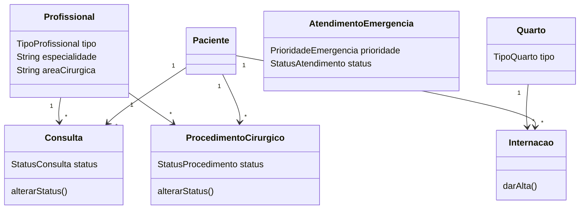

# MedFlow API

API REST da Sprint 2, construída com Spring Boot 3 e Java 25. Os dados ficam em
memória enquanto a aplicação está em execução, o que permite testar o modelo sem
configuração de banco de dados.

## Executar

Com Java 25 e Maven instalados:

```bash
cd backend
mvn spring-boot:run
```

## Endpoints

| Recurso | Operações principais |
|---|---|
| `/pacientes` | `GET`, `POST`, `PUT /{id}`, `DELETE /{id}` |
| `/profissionais` | `GET`, `POST`, `PUT /{id}`; filtros `tipo` e `especialidade` |
| `/consultas` | `GET`, `POST`, `PATCH /{id}/status`; filtro `status` |
| `/internacoes` | `GET`, `POST`, `PATCH /{id}/alta` |
| `/quartos` | `GET`, `POST`, `PATCH /{id}/disponibilidade` |
| `/procedimentos-cirurgicos` | `GET`, `POST`, `PATCH /{id}/status` |
| `/emergencias` | `GET`, `POST`, `PATCH /{id}/iniciar`, `PATCH /{id}/concluir` |

Os valores de enumeração são usados no JSON, por exemplo `ESPECIALISTA`,
`EM_ATENDIMENTO`, `CRITICA` e `CONCLUIDA`. A transição de consulta só aceita o
fluxo de negócio definido em `StatusConsulta`; procedimentos cirúrgicos só podem
ser concluídos depois de iniciados; e uma internação ocupa o quarto até a alta.

Para criar uma consulta especializada, o `tipo` deve ser `ESPECIALIZADA` e
`especialidade` deve ser igual à especialidade do profissional responsável.

## Diagrama de classes


